 

&nbsp;&nbsp;

---

### 👋 About

I build AI systems that act in the real world, and the guardrails that keep them honest. Currently shipping at **Doris Labs**. I have a research background in hybrid SSM-attention architectures.

- 🛡️ Made **[Bastion](https://github.com/rayaan2003/bastion)**: runtime policy enforcement for AI agent tool calls
- 🔬 Studied hybrid SSM-attention networks for my dissertation
- 📍 Based in London

---

### 🚀 Featured work

<table>
<tr>
<td width="50%" valign="top">

#### 🛡️ [bastion](https://github.com/rayaan2003/bastion)
Block, approve, or log unsafe AI agent tool calls **before** they execute.

</td>
<td width="50%" valign="top">

#### 🧠 [hybrid-ssm-attention-dissertation](https://github.com/rayaan2003/hybrid-ssm-attention-dissertation)
Architectural mixing strategies for hybrid SSM-attention networks: efficiency and generalisation.

</td>
</tr>
<tr>
<td width="50%" valign="top">

#### 🔌 [mcp-agent](https://github.com/rayaan2003/mcp-agent)
Fork of an agent framework built on the Model Context Protocol.

</td>
<td width="50%" valign="top">

#### 📄 [Papers-Research](https://github.com/rayaan2003/Papers-Research)
Papers and reports I've published.

</td>
</tr>
</table>

---

---

### 📊 GitHub stats

---

Always up for talking agents, safety, and building in public.

